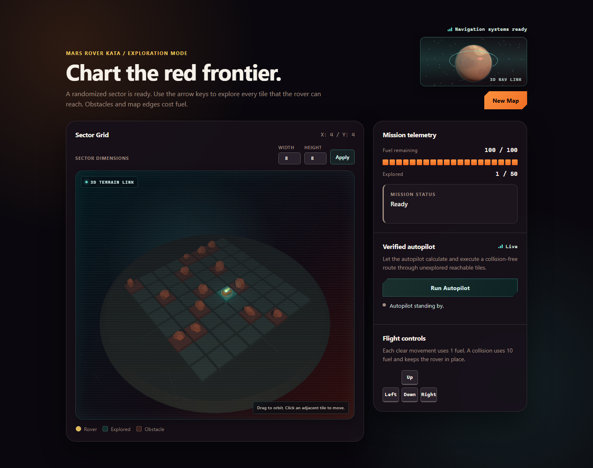

# Mars Rover KATA

An interactive implementation of the four-phase Mars Rover KATA, with a
verified deterministic autopilot, an accessible Three.js dashboard, and an
optional local OpenAI agent.



**Live dashboard:** <https://t2yijaeho.github.io/mars-rover-kata/>

The public GitHub Pages build is entirely static. It plans routes in the
browser, makes no backend request, and never receives an OpenAI key.

## Features

- Phase 1-4 movement, boundary and obstacle checks, fuel, reachable-area
  tracking, completion, keyboard controls, and resizable maps.
- Verified breadth-first route planning shared across Python and JavaScript
  fixtures.
- Responsive semantic UI with reduced-motion support and a usable fallback
  when WebGL is unavailable.
- FastAPI endpoints at `/health`, `POST /api/rover`, and
  `POST /api/agent/simulate`.
- Optional AI planning that is disabled by default and accepted only when it
  exactly matches the verified safe route.

## Local development

Install [uv](https://docs.astral.sh/uv/) and Node.js, then:

```powershell
uv sync --locked
Push-Location web
npm ci
npm run dev
```

Vite serves the dashboard at <http://127.0.0.1:5173>. In another terminal, run
the optional API:

```powershell
uv run uvicorn main:app --reload
```

The Vite development server proxies `/api` and `/health` to port 8000. To serve
one integrated production build locally:

```powershell
Push-Location web
npm run build
Pop-Location
uv run uvicorn main:app
```

## Optional OpenAI autopilot

Copy `.env.example` to the already-ignored `.env`, then set:

```dotenv
ENABLE_OPENAI_AUTOPILOT=true
OPENAI_API_KEY=your-key
OPENAI_MODEL=your-model
```

Start with explicit environment-file loading:

```powershell
uv run uvicorn main:app --env-file .env
```

An API key by itself does not enable model calls. Tests inject network-disabled
settings and do not load `.env`.

## Verification

```powershell
python .agents/skills/maintain-mars-rover/scripts/check_release.py
```

This runs locked Python and npm installs, linting, unit and browser tests,
coverage, dependency audits, static security analysis, a tracked-file secret
scan, GitHub Pages path checks, and production builds.

The roadmap in `docs/PHASES/` remains the behavior source of truth.

## Deployment

GitHub Actions builds `web/` with the `/mars-rover-kata/` base path and deploys
the static artifact to GitHub Pages. A future hosted FastAPI/OpenAI deployment
can use [Render's FastAPI web-service flow](https://render.com/docs/deploy-fastapi);
no Render service is part of this release.

## Security and license

Please report vulnerabilities through GitHub private vulnerability reporting as
described in [SECURITY.md](SECURITY.md). This project is released under the
[MIT License](LICENSE).
